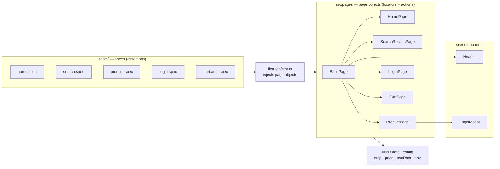
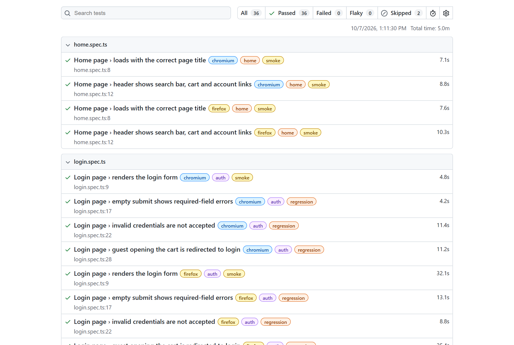
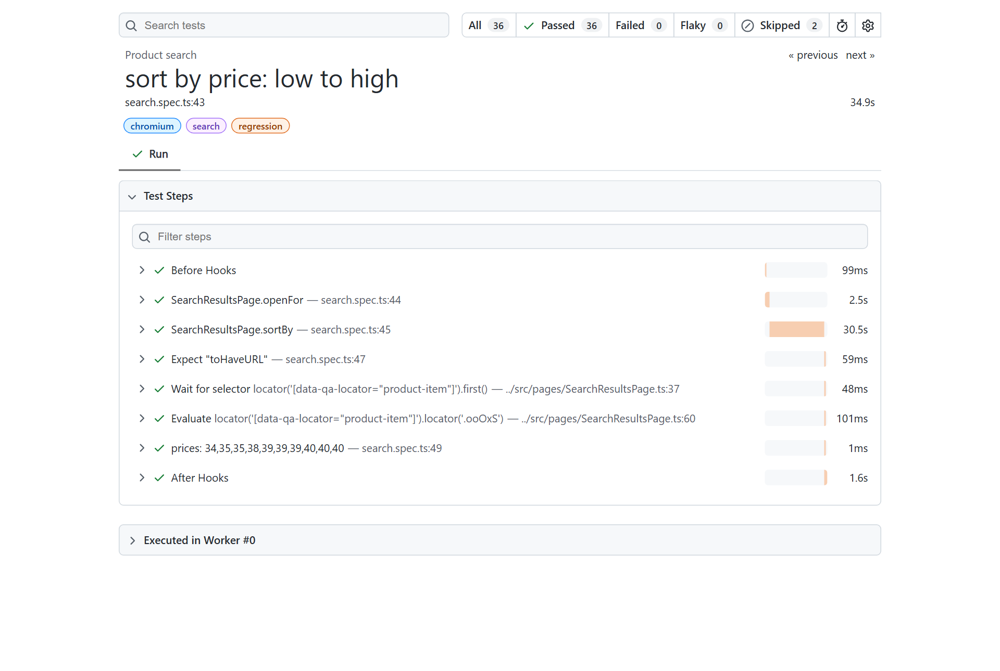
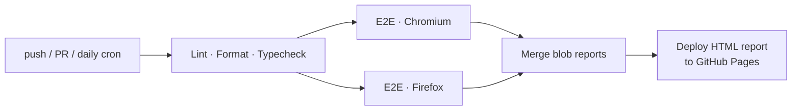

<div align="center">

# Daraz E2E Test Automation

**Production-style UI test automation framework for [daraz.com.bd](https://www.daraz.com.bd) — Bangladesh's largest e-commerce platform.**

Built with **Playwright + TypeScript** using the **Page Object Model**, with cross-browser runs, CI/CD on GitHub Actions and a published HTML report.

[](https://github.com/Bijoy2428/daraz-playwright-automation/actions/workflows/playwright.yml)


[Live Test Report](https://bijoy2428.github.io/daraz-playwright-automation/) · [Test Coverage](#-test-coverage) · [Getting Started](#-getting-started)

</div>

---

## ✨ Highlights

- **Page Object Model** with reusable **components** (header, login modal) composed into pages
- **Custom fixtures**: specs receive ready-to-use page objects (`async ({ productPage }) => …`)
- **`@step` decorator**: every page-object action appears as a named step in reports and traces
- **Tagged suites**: `@smoke`, `@regression` and feature tags (`@search`, `@product`, …) using Playwright's native tag API
- **Cross-browser**: Chromium and Firefox, run in parallel
- **Debuggable failures**: screenshot, video and trace are kept for every failed test
- **CI/CD**: lint → typecheck → matrix E2E run → merged HTML report deployed to GitHub Pages, plus a **daily scheduled run** to catch site changes
- **Code quality**: ESLint (`typescript-eslint` + `eslint-plugin-playwright`), Prettier, strict TypeScript
- **Ethical by design**: the login CAPTCHA is **never** bypassed; authenticated tests reuse a manually saved session

## 🧱 Architecture



**Separation of concerns.** Page objects contain only locators and user-level actions. All assertions live in the specs. Selectors are defined in exactly one place, so a UI change means editing one file.

```
├── src/
│   ├── pages/           # BasePage, HomePage, SearchResultsPage, ProductPage, LoginPage, CartPage
│   ├── components/      # Header, LoginModal (shared UI pieces)
│   ├── fixtures/        # custom `test` with page-object fixtures
│   ├── utils/           # @step decorator, price parsing & sort helpers
│   ├── data/            # test data
│   └── config/          # environment config (.env support)
├── tests/               # *.spec.ts — test scenarios
├── scripts/save-auth.ts # one-time manual login → saved session
├── playwright.config.ts # projects, retries, reporters, artifacts
└── .github/workflows/   # CI pipeline
```

## ✅ Test Coverage

| Area        | Scenario                                                  | Tags                |
| ----------- | --------------------------------------------------------- | ------------------- |
| **Home**    | Page loads with the correct title                         | `@smoke`            |
|             | Header shows search bar, cart, login and sign-up links    | `@smoke`            |
| **Search**  | Search returns results for several keywords (data-driven) | `@smoke`            |
|             | Search via the SEARCH button                              |                     |
|             | Result titles are relevant to the keyword                 | `@regression`       |
|             | Sort by price low → high (prices actually verified)       | `@regression`       |
|             | Sort by price high → low (prices actually verified)       | `@regression`       |
|             | Pagination to page 2 shows different products             | `@regression`       |
| **Product** | Opens the same product that was clicked                   | `@smoke`            |
|             | Shows price, Buy Now and Add to Cart                      | `@smoke`            |
|             | Quantity picker increments and decrements                 | `@regression`       |
|             | Guest "Add to Cart" opens the login modal                 | `@regression`       |
| **Login**   | Login form renders with social login options              | `@smoke`            |
|             | Empty submit shows required-field errors                  | `@regression`       |
|             | Invalid credentials are rejected                          | `@regression`       |
|             | Guest visiting the cart is redirected to login            | `@regression`       |
| **Cart**    | Logged-in user opens the cart / adds a product            | needs saved session |

**36 tests passing** across Chromium and Firefox (2 skipped until a session is saved).

## 📊 Reports

<table>
<tr>
<td></td>
<td></td>
</tr>
<tr>
<td align="center">Report overview with tags</td>
<td align="center">Readable steps from the <code>@step</code> decorator</td>
</tr>
</table>

## 🚀 Getting Started

**Prerequisites:** Node.js 20+

```bash
git clone https://github.com/Bijoy2428/daraz-playwright-automation.git
cd daraz-playwright-automation
npm ci
npx playwright install chromium firefox
cp .env.example .env    # optional: set HEADLESS=false to watch the browser
```

### Run tests

| Command                              | Description                     |
| ------------------------------------ | ------------------------------- |
| `npm test`                           | Full suite, all browsers        |
| `npm run test:smoke`                 | Smoke suite (Chromium)          |
| `npm run test:regression`            | Regression suite                |
| `npm run test:headed`                | Run with a visible browser      |
| `npm run test:ui`                    | Playwright UI mode, interactive |
| `npm run test:debug`                 | Step through with the Inspector |
| `npm run report`                     | Open the last HTML report       |
| `npm run lint` / `npm run typecheck` | Code quality checks             |

### Logged-in tests

Daraz protects login with a slider CAPTCHA, and this project deliberately does **not** automate around it. Save a session once by hand, then reuse it:

```bash
npm run auth:save   # a browser opens: log in manually, then click "Resume" in the Inspector
npm run test:auth   # runs *.auth.spec.ts with the saved session
```

The session is stored in `.auth/` and is git-ignored.

## 🧩 Example

```ts
test('sort by price: low to high', { tag: '@regression' }, async ({ searchResultsPage, page }) => {
  await searchResultsPage.openFor('mouse');
  await searchResultsPage.sortBy('Price low to high');

  await expect(page).toHaveURL(/sort=priceasc/);
  const prices = await searchResultsPage.productPrices(10);
  expect(isSortedAscending(prices)).toBe(true);
});
```

## 🔄 CI/CD Pipeline



## 🛠 Tech Stack

Playwright · TypeScript · Node.js · ESLint · Prettier · GitHub Actions · GitHub Pages

## ⚠️ Disclaimer

This is a personal portfolio project for learning and demonstrating test automation. It is not affiliated with Daraz. The tests are read-only (no orders are placed) and run at a low, human-like volume.

## 📄 License

[MIT](LICENSE)
